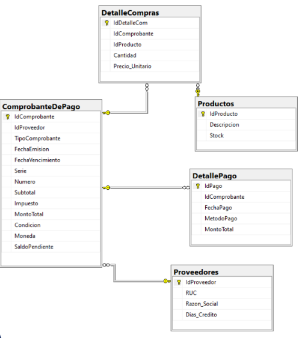
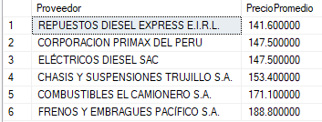
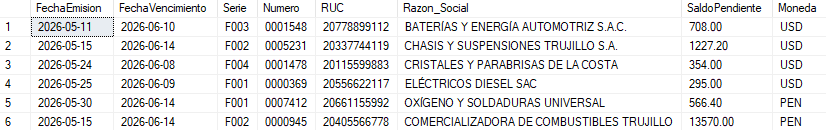
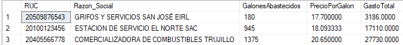
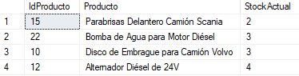
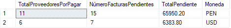

# 📊 Proyecto de Análisis de Compras, Inventario y Cuentas por Pagar (SQL Server)

## 📝 Descripción del Proyecto
Este proyecto contiene el diseño, creación y análisis de una base de datos relacional, orientada a la gestión de proveedores, control de inventario de repuestos y monintoreo de cuentas por pagar para implementar a una empresa que solo maneja sus datos en Excel.

## 🛠 Herramientas y Tecnologías
* **Motor de Base de Datos:** SQL Server
* **Técnicas SQL Aplicadas:** Stored Procedures, Joins múltiples, Subconsultas, funciones de agregación y manejo de fechas.

## 🗂 Estructura de los Datos (Esquema)
El análisis se basó en una base de datos relacional con las siguientes tablas principales:
* `Proveedores`: Registro de datos de empresas proovedoras.
* `Productos`: Catálogo de repuestos, lubricantes y combustible, incluyendo el stock total.
* `ComprobantesDePago`: Registro de datos de facturas recibidas.
* `DetalleCompras`: Registro de detalle de productos adquiridos por cada comprobante.
* `DetallePago`: Registro de las transacciones financieras realizadas.

*Diagrama base de datos*

## 🔍 Consultas Destacadas
* **Automatización (Stored Procedures):**

    -sp_PrecioPromedioPorProveedor: Calcula el precio promedio histórico de un producto específico según las compras realizadas a cada proveedor.   
    

    -sp_ConsultarFacturaPorPagar: Genera un reporte semanal de saldos pendientes filtrado por un rango de fechas de vencimiento.
    

* **Gasto total de combustible:** Cálculo del gasto total de combustible abastecido, incluyendo el cálculo del precio por galón con impuestos.
 

* **Gestión de inventarios:** Detección de productos con stock crítico para planificar reabastecimiento.
  

* **Resumen gerencial:** Consolidación del saldo pendiente total por pagar, contabilizando el número de facturas y proovedores únicos por pagar, agrupados por tipo de moneda.
  

